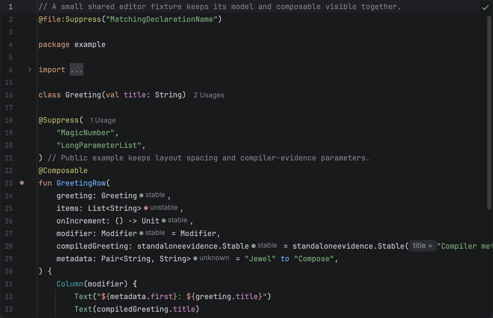
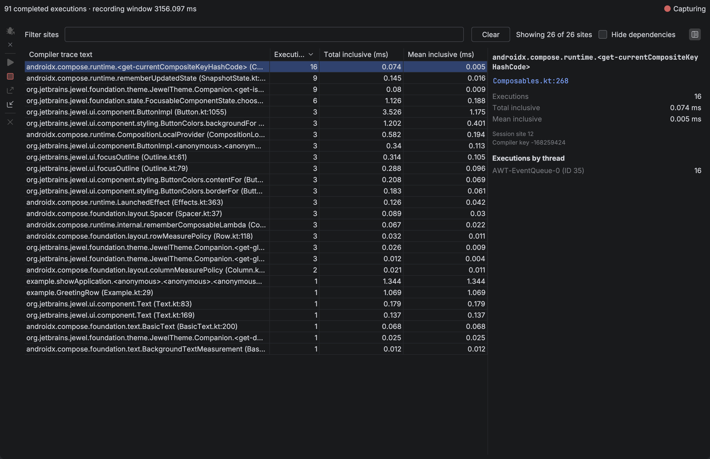

# Jewel Tooling

Jewel Tooling helps Compose UI authors inspect their code in IntelliJ IDEA. The plugin estimates each `@Composable` parameter's stability. It also records composition activity during local development runs.

Editor hints work without extra dependencies, source changes, or a server. For live inspection, the plugin adds its bundled agent to a temporary copy of an existing run configuration.

Version 0.9.0 targets IntelliJ IDEA 2026.2.0.1 (build 262.8665.337). It uses the bundled Kotlin plugin in K2 mode. Install from [JetBrains Marketplace](https://plugins.jetbrains.com/plugin/34392-jewel-tooling), a [GitHub Release](https://github.com/rock3r/jewel-tooling/releases), or a ZIP built from this repository.

## What you get

The editor shows hints after parameter types in project Kotlin files and attached dependency sources. Hover over a hint to read its reason. Click a function's gutter icon to inspect all its inputs.

Choose **Run with Compose Inspection** to launch the selected configuration and connect to its target. The **Live recompositions** tab updates as you use the UI. Matching function and property lines show inclusive duration badges. Each duration includes nested calls and capture overhead. These measurements cannot establish frame times, skipped calls, or performance problems.

## Start here

| Page | Use it to |
| --- | --- |
| [Install](install.md) | Build or install the plugin and open a Gradle or Bazel project |
| [Editor hints](editor.md) | Read stability estimates, evidence, and limits |
| [Live inspection](live-inspection.md) | Launch, capture, filter, and stop a local session |
| [Recordings](recordings.md) | Open a saved session and read its measurements |
| [Customisation](customisation.md) | Change hint colours, gutters, and inlay visibility |
| [Agents](agents/README.md) | Use the same static analysis from a coding agent |

For contributor setup, read [CONTRIBUTING.md](../CONTRIBUTING.md). The [internal docs](../docs/architecture.md) cover architecture, tests, and conventions.
