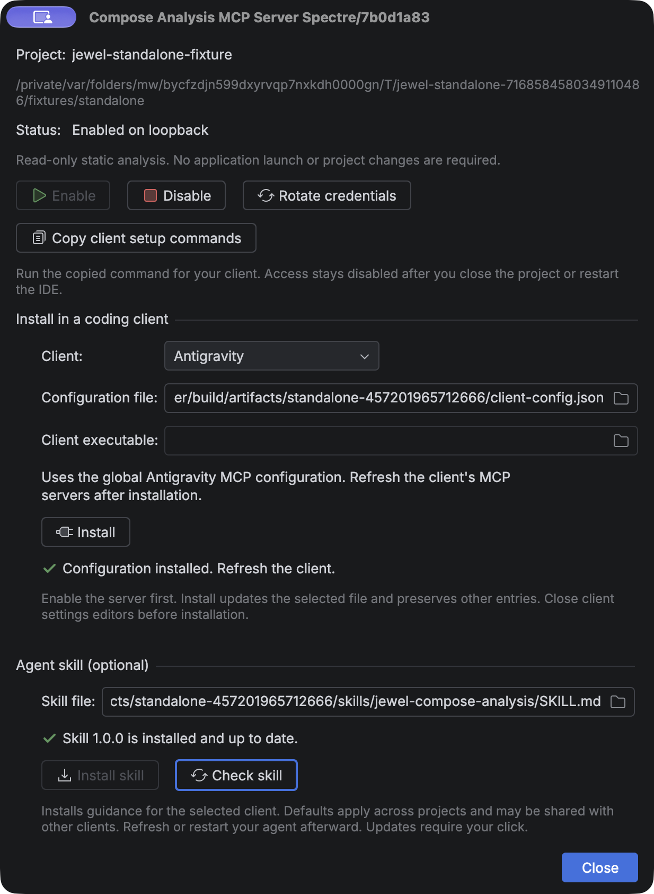

# Use Compose analysis from a coding agent

Jewel Tooling gives coding agents access to the editor's static Compose stability engine through the Model Context Protocol (MCP). Keep the project open in your IDE. Analysis requires no application launch, build plugin, or dependency change.

## Enable access to your project

1. Install Jewel Tooling in a supported IntelliJ IDEA installation.
2. Open your own Gradle or Bazel project. Import its Kotlin model and let indexing finish.
3. Open **Tools → Compose Analysis MCP Server…**.
4. Check the project name and path. Select **Enable**.
5. Under **Install in a coding client**, select your client. Check the configuration file path.
6. Select **Install**. Jewel Tooling writes and verifies the configuration.
7. Refresh or restart your client. Accept its own trust prompt if shown.

If detection leaves **Client executable** empty for Codex or Pi, set the path yourself. For manual Codex or Claude Code configuration, select **Copy client setup commands**.

Project access starts disabled. After closing the project or restarting the IDE, enable access again. Clients keep their existing configuration without a new port or token. This endpoint operates separately from live Compose inspection and other IDE MCP servers.

The IDE needs a working Kotlin project model. Missing dependencies can leave findings unknown. For Bazel projects, analysis uses the imported IDE model. It never runs Bazel or guesses dependencies from build files.

## One-click client setup



The installer supports the clients below. By default, it writes local user configuration. Each server entry identifies the current IDE profile and project. Installation preserves other server entries.

| Client | Default configuration | After installation |
| --- | --- | --- |
| Android Studio (Gemini) | Selected Android Studio profile's `mcp.json` | Enable MCP Servers in Studio, then refresh its MCP settings |
| Antigravity | `~/.gemini/config/mcp_config.json` | Refresh MCP servers |
| Codex | `$CODEX_HOME/config.toml`, or `~/.codex/config.toml` | Reconnect MCP or restart the session |
| Claude Code | `~/.claude.json` | Restart the session |
| Pi (pi-mcp-adapter) | `$PI_CODING_AGENT_DIR/mcp.json`, or `~/.pi/agent/mcp.json` | Restart Pi, then inspect `/mcp` |
| Amp | `~/.config/amp/settings.json` or `.jsonc` | Refresh MCP or restart the session |
| OpenCode | `~/.config/opencode/opencode.json` or `.jsonc` | Restart the session |
| GitHub Copilot (JetBrains) | `~/.config/github-copilot/intellij/mcp.json` | Refresh Copilot's MCP servers |
| GitHub Copilot (CLI) | `~/.copilot/mcp-config.json` | Restart the session |
| GitHub Copilot (VS Code) | VS Code's user `mcp.json` | Refresh MCP servers |

The dialog resolves platform paths and configuration-directory overrides. For custom profiles, select the client's actual configuration file. Choose an Android Studio profile explicitly when several exist. Studio requires a file outside the project in an existing profile with an `options` directory. Installation leaves global client trust and approval settings unchanged.

Pi integration uses **pi-mcp-adapter**. If no adapter package is registered, the installer runs `pi install npm:pi-mcp-adapter@2.34.0`. It preserves existing registered adapters. Package installation requires registry access. For other Pi extensions, ask your agent to adapt the setup. The adapter can expose tools through its `mcp` proxy. Inspect the connection with `/mcp`.

See [Agent skill](skill.md) to install the optional analysis instructions.

### Android Studio and endpoint changes

Android Studio requires HTTP MCP because it cannot use stdio. Its configuration includes a bearer credential. Jewel Tooling gives only the owner access to that file and its backup. Keep Studio configuration private and outside version control.

Enabling the server or rotating credentials updates the Studio entry owned by Jewel Tooling. Disabling access, closing the project, or unloading the plugin revokes access. Jewel Tooling then disables its Studio entry and removes the credential. Refresh Studio's MCP settings after updates.

An IDE crash prevents cleanup. The old endpoint still stops granting access. After restarting, enable the server to refresh the saved entry. Manual entry edits stop automatic updates and produce a warning. To restore updates, remove only the affected Jewel entry in Studio. Then select Install again.

Other clients connect through the private discovery bridge. Their saved configuration excludes tokens and temporary ports.

### Existing settings and installation failures

Close editors for client configuration files before installing. Client applications can also write these settings. Jewel Tooling checks for changes before and after writes, but cannot lock out other applications. When it detects a change, installation stops and asks you to close the editor and retry. Installation success confirms saved configuration only. Check the external client separately for a live connection.

JSON and JSONC writes preserve unrelated text and comments. The installer rejects duplicate keys and malformed files. Its private IDE support directory holds one backup per destination. Jewel Tooling never automatically restores that backup over another application's edits.

Configuration files have a 1 MiB limit. Claude Code's state file allows 32 MiB. Nesting has a 64-level limit. The installer rejects symbolic links and files owned by other users. Select a direct destination that you own.

The installed Codex CLI validates a private TOML copy. Installation preserves the original text and appends a server table. Unusual inline tables, old CLIs, or conflicting entries can block installation. In those cases, use the copied command. If moving the IDE changes its Java path, remove the old named Codex entry and reinstall.

You can retry installation safely. The installer preserves identical entries and refuses to overwrite conflicting user entries. If Pi's package installs but configuration fails, retry setup. After deleting or replacing a project, remove the old Jewel entry from every client. Uninstalling Jewel Tooling leaves other applications' settings in place. The stopped endpoint denies access.

The configuration formats follow these vendor references:
[Android Studio](https://developer.android.com/studio/gemini/add-mcp-server),
[Antigravity](https://antigravity.google/docs/mcp),
[Amp](https://ampcode.com/docs/customize/mcp),
[OpenCode](https://opencode.ai/docs/mcp-servers/),
[Pi adapter](https://github.com/nicobailon/pi-mcp-adapter),
[Copilot IDE clients](https://docs.github.com/en/copilot/how-tos/provide-context/use-mcp-in-your-ide/extend-copilot-chat-with-mcp),
and [Copilot CLI](https://docs.github.com/en/copilot/how-tos/copilot-cli/customize-copilot/add-mcp-servers).
The setup workflow draws on the [IDE Index MCP plugin](https://github.com/hechtcarmel/jetbrains-index-mcp-plugin). Jewel Tooling copies none of its source code.

## Manual setup for Codex or Claude Code

Copy setup commands from the IDE to get its Java executable, bootstrap path, descriptor path, and project identity. The paths below are **examples**. Replace them with the values copied from your installation.

```sh
codex mcp add jewel-example -- '/path/to/ide/jbr/bin/java' -jar '/private/support/bootstrap.jar' '/private/support/project.properties' 'PROJECT_ID'
claude mcp add --transport stdio jewel-example -- '/path/to/ide/jbr/bin/java' -jar '/private/support/bootstrap.jar' '/private/support/project.properties' 'PROJECT_ID'
```

Run the command for your chosen client only. Restart the session or use the client's MCP controls to reconnect. The commands follow [Codex MCP syntax](https://developers.openai.com/codex/mcp/) and [Claude Code stdio syntax](https://code.claude.com/docs/en/mcp). Checks against the installed CLIs confirmed these argument forms.

Configuration files use the same values. Here is an **example** for Codex TOML:

```toml
[mcp_servers.jewel_example]
command = "/path/to/ide/jbr/bin/java"
args = ["-jar", "/private/support/bootstrap.jar", "/private/support/project.properties", "PROJECT_ID"]
```

For Claude Code, the equivalent JSON **example** is:

```json
{
  "mcpServers": {
    "jewel_example": {
      "type": "stdio",
      "command": "/path/to/ide/jbr/bin/java",
      "args": ["-jar", "/private/support/bootstrap.jar", "/private/support/project.properties", "PROJECT_ID"]
    }
  }
}
```

Copied commands use POSIX shell quoting. On Windows, use JSON configuration with escaped backslashes or forward slashes. The launcher uses Java bundled with the selected IDE. Moving or removing the IDE requires copying setup again.

Each descriptor identifies one IDE profile and project. Assign a separate client name to each endpoint. Keep the original project identity in each entry. The bridge never chooses the first running IDE. Copy setup again after moving or recreating a project.

The client launches a local stdio bridge. The bridge reads private discovery data, then connects through authenticated loopback HTTP. Keep the credential-bearing descriptor private and outside version control. Copied client configuration has no credential. Each enable operation creates a fresh credential and endpoint generation.

## First analysis in your project

Give the agent the following sequence. Some clients add a prefix to tool names.

1. Call `jewel_status` with `{}`. Check `projectRoot`, `projectId`, and `readiness`.
2. Call `jewel_composables` with `{"file":"src/main/kotlin/example/Screen.kt"}`.
3. Select a returned declaration ID. Call `jewel_analyze` with the same file and that `declarationId`.
4. Call `jewel_explain` with the file, declaration ID, and parameter name.
5. Cite the declaration location, document hash, classification, evidence, and reason in your explanation.

The following requests show **example** arguments:

```json
{"file":"src/main/kotlin/example/Screen.kt","declarationId":"GENERATION:FILE_HASH:CONTENT_HASH:OFFSET"}
```

```json
{"file":"src/main/kotlin/example/Screen.kt","declarationId":"GENERATION:FILE_HASH:CONTENT_HASH:OFFSET","parameter":"items"}
```

Replace the example ID with the returned declaration ID. To explain an extension receiver, name the parameter `<receiver>`. The tool explains a parameter's resolved type within its declaration. Arbitrary type strings are unsupported.

Results share the following envelope. This **representative excerpt** omits parts of the full response:

```json
{
  "schemaVersion": 1,
  "payload": {
    "kind": "result",
    "data": {
      "file": "src/main/kotlin/example/Screen.kt",
      "documentRevision": "42",
      "contentHash": "SHA256_OF_CURRENT_DOCUMENT",
      "declarations": [{
        "name": "Screen",
        "parameters": [{
          "name": "items",
          "resolvedType": "kotlin.collections.List<example.Item>",
          "stability": "UNSTABLE",
          "evidence": [{"code": "BUILTIN", "provenance": "builtin"}],
          "reasons": [{"code": "reason.collection", "text": "The collection type does not guarantee immutability.", "locations": []}],
          "incomplete": []
        }],
        "skippability": "NOT_ANALYZED"
      }]
    }
  }
}
```

## Contract and evidence

All four tools allow read-only access. MCP tool discovery publishes their `inputSchema` and `outputSchema`. Successful responses contain `schemaVersion: 1` and a `payload` with `kind: "result"` and `data`. Operational errors contain `kind: "error"`, `code`, `message`, `retryable`, and `remedy`. MCP also sets `isError`. The published output schema covers success and error responses.

Use `jewel_status` to check versions, project identity, readiness, capabilities, and limits. The other three tools return document snapshots containing declaration and parameter details. `jewel_composables` adds stability summaries. `jewel_explain` returns details for only the selected parameter.

Snapshots record the document revision, SHA-256 content hash, and Program Structure Interface (PSI) revision. Each declaration ID belongs to an endpoint generation, canonical project-relative file, and document hash. Locations count lines and columns from one, using UTF-16 code units. Ranges exclude their end location.

Without a selector, `jewel_analyze` analyses the named file. A range selects declarations with names starting inside that range. A zero-width range selects the innermost function containing the location. Supply either a range or a declaration ID. All three analysis tools can reject changed documents through optional `expectedHash` arguments.

| Evidence | Meaning |
| --- | --- |
| `COMPILER_METADATA` | Supported compiled metadata contributes to the classification |
| `DECLARED_CONTRACT` | The resolved type declares a stability annotation contract |
| `SOURCE` | The engine infers stability from supported source declarations |
| `BUILTIN` | The engine applies a known language or library rule |
| `UNSUPPORTED` | The available evidence does not support a conclusion |

A result can combine evidence types. Include every entry in explanations. Declared contracts cannot prove that implementations fulfil them. Add `@Stable` or `@Immutable` only when the implementation preserves the promised behaviour.

Preserve `UNKNOWN` classifications in explanations. Incomplete entries identify missing metadata, unresolved types, unsupported evidence, or exhausted analysis budgets. Missing metadata leaves a partial finding while the whole-file request can still succeed. Stability cannot establish compiler skippability, recomposition counts, or performance problems. Responses contain no runtime observations and use `skippability: NOT_ANALYZED`.

## Unsaved edits and limits

Tools analyse the current editor document, including unsaved changes, without saving it. Writes can invalidate snapshots. After `STALE_LOCATION`, list declarations again and select the new ID. Dependency changes can invalidate findings even with an unchanged source hash. Analyse again before citing a finding.

Name one project-relative Kotlin file per request. Tools never scan the repository implicitly. Limits are 1 MiB of source, 128 declarations, 256 parameters, and 1 MiB of encoded output. Each project allows two concurrent analyses. Further requests receive `BUSY`. Requests have a ten-second deadline. Exceeding a limit produces an explicit failure without silently omitting declarations.

Client cancellation stops analysis and can leave the MCP request without a response. Closing a session cancels all its analyses. Dropping HTTP alone does not cancel analysis. The request deadline still applies after disconnection. Idle sessions expire to release capacity.

## Disable or rotate access

Choose **Disable** to revoke access and stop the endpoint. Project close and plugin unload also stop the endpoint. Choose **Rotate credentials** to replace credentials and close existing sessions. Reconnect clients after rotation. Stdio discovery paths remain unchanged. Jewel Tooling updates the Android Studio entry it owns. Refresh Studio's settings afterward.

## Troubleshooting

| Symptom | Action |
| --- | --- |
| The bridge cannot connect | Open the selected project, enable MCP, and reconnect the client |
| `INDEXING` | Wait for indexing to finish; check `jewel_status` again |
| `UNKNOWN` with unresolved evidence | Fix or import the Kotlin dependency model; request fresh analysis |
| `METADATA_UNAVAILABLE` in a parameter | Keep the result unknown; compiler evidence is not available for that classification |
| `STALE_LOCATION` | List composables again; use the new declaration ID and hash |
| `BUSY` | Let an existing request finish before retrying |
| `TIMEOUT` | Wait for the IDE to become idle or analyse a smaller range |
| `LIMIT_EXCEEDED` | Analyse a smaller file, range, or declaration |
| `OUTSIDE_PROJECT` | Use a file inside the selected imported project |
| The wrong project appears in status | Remove that client entry and copy setup from the intended project's dialog |
| Setup fails on permissions | Use an owner-only IDE configuration directory; do not make the discovery files public |
| Access stops after rotation or restart | Re-enable if needed, then reconnect the client with its existing configuration |
