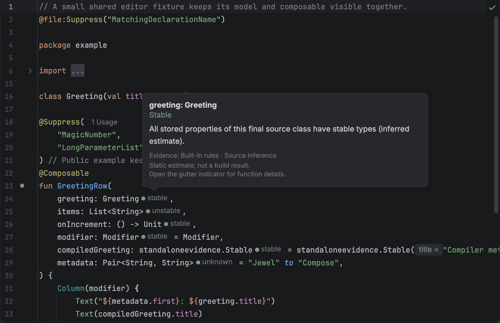
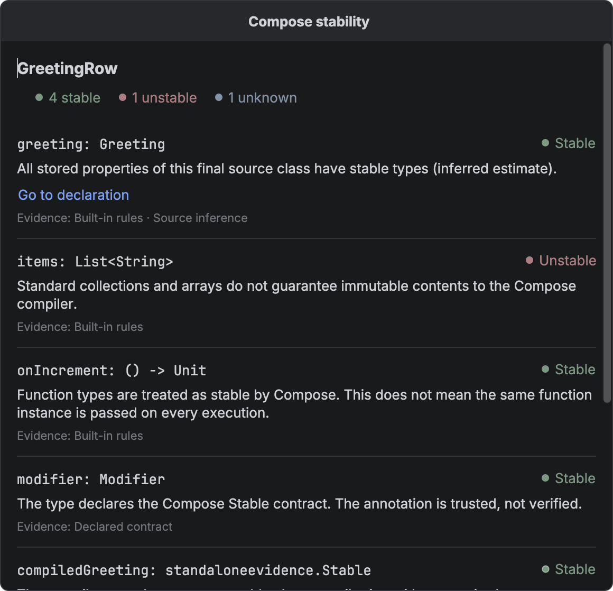
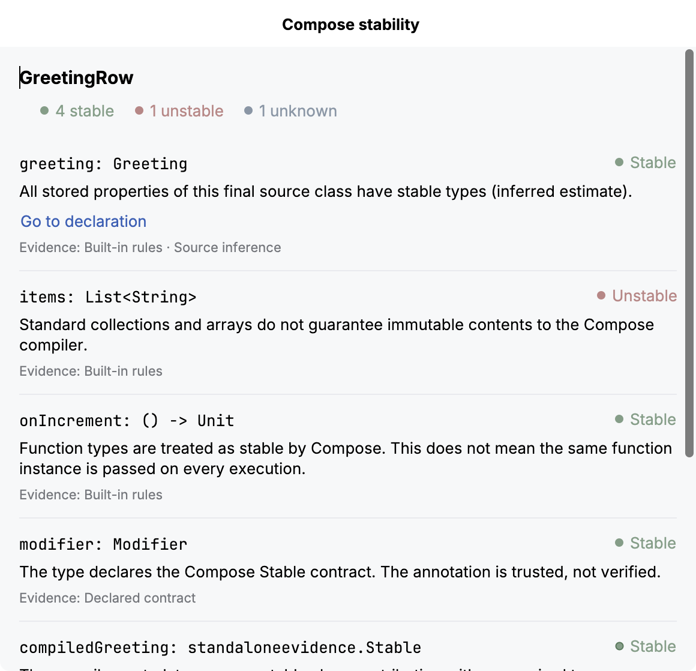

# Editor hints

The editor estimates stability for each parameter of a Kotlin `@Composable` function. Hover over a parameter hint to read the reason. To inspect all inputs, click the function's gutter indicator.

Jewel Tooling uses conservative static estimates. It does not produce Compose compiler reports or predict recomposition. Strong skipping can skip a function with an unstable parameter when the relevant identity stays unchanged.

## What a hint means

| Hint | Meaning |
| --- | --- |
| stable | A recognized stable type, a trusted Compose stability contract, an inferred final source class whose stored properties have stable types, or supported compiler metadata with stable selected type arguments. |
| unstable | A standard collection or array, a vararg, a class with a mutable or unstable stored property, or a supported compiler metadata result that proves instability. |
| unknown | The type is unresolved, outside the supported inference rules, or too expensive to analyse within the fixed budget. |

Each explanation names the rule behind the estimate. The plugin trusts `@Stable` and `@Immutable` contracts without checking whether the implementation keeps their promises. Add these annotations only when the implementation meets their contracts.

Hints combine a small circle with a text label. The circle is green for stable, muted red for unstable, and blue-grey for unknown.

Circles without a border identify inference, built-in rules, or declared contracts. A 1-point border identifies stability confirmed by supported compiler metadata. Mixed evidence has no border. A source class therefore stays borderless when only one property has compiler metadata. The border gives no information about composable skipping.

The IDE's standard inlay text colour applies to hint labels. Unknown results have no border. See [Customisation](customisation.md) to change the colours.

## Inspect a function

Open **Compose stability** from a composable function's gutter indicator. The popup lists the function name and status counts. Each input includes its source type, explanation, and evidence. Labels identify built-in rules, declared contracts, source inference, and compiler metadata. Generic types can combine evidence from several sources.

The popup estimates input stability. It cannot establish whether the function is skippable.

For keyboard access, place the caret inside the function. Open **Find Action** and choose **Inspect Compose Stability**. The editor context menu also includes this action. The popup supports text selection, copying, scrolling, and resizing. Press **Escape** to return to the editor. Source edits and editor switches close the popup to prevent stale results.

Use **Go to declaration** to open the property or inferred stable class responsible for a result. Nested explanations can link to properties in other source classes. The plugin uses resolved declarations within the same IDE module. Keyboard users can follow these links. Screen readers receive the parameter name with each link.

If indexing starts or project source changes, the plugin stops navigation from the old analysis. Reopen the details to refresh navigation targets. Explanations without supported source targets have no link. The plugin never guesses source links from compiler text or binary metadata.

The counts cover value parameters and any extension receiver. Analysis excludes context parameters. The popup states when a function has no covered inputs. For gutter icons, unstable takes priority over unknown. Unknown takes priority over stable.

## Compiler evidence

Jewel Tooling reads existing Compose stability metadata from resolved binary dependency classes. Reading never loads or executes the class. The inspected project needs no extra plugin or dependency.

The reader supports Kotlin metadata versions `[2, 3, 0]` and `[2, 4, 0]` in nonpreview Java 8–25 class files. It rejects preview classes. See the [testing guide](../docs/testing.md#compatibility) for the compiler configurations used to generate test fixtures.

Metadata versions cannot identify a compiler patch version. The reader returns **unknown** for computed stability initializers and other unsupported shapes. Other metadata versions and classes newer than Java 25 also produce **unknown**. Support for these formats does not cover all published Jewel or Compose libraries.

Generic class metadata selects the type arguments that affect stability. For a compiled `Box<T>(val value: T)`, analysis combines the compiler's class result with `T`'s result. A required star projection produces unknown. Unused type arguments have no effect. When compiler and source evidence both contribute, the details view labels each separately.

Class results cannot establish function restartability or skippability. Jewel Tooling does not read stability configuration files. A recognized `@Stable` or `@Immutable` contract can establish stability even when dependency metadata is unsupported.

## Limits

Hints cover value parameters and extension receivers. Context parameters have no hints. An explicit `FunctionN` class reference can stay unknown even when equivalent syntax such as `() -> Unit` is stable.

Analysis excludes external stability configuration files, custom contracts, and inherited contracts. Unannotated library types, including `Pair` and `Triple`, stay unknown. Singleton objects and value classes, including unsigned types, need a recognized contract to avoid an unknown result.

Generic substitution supports concrete stored types. The recursion guard stops repeated instances of the same class, including `Box<Box<String>>`. Recursive types stay unknown. Inner and local classes stay unknown because they can capture state beyond their declared properties. Instance storage excludes computed properties without backing fields and companion state. Delegated storage produces unknown.

Analysis visits the extension receiver first, then parameters in declaration order. Each function has a budget of 256 type visits and a nesting depth of 12. Completed hints survive budget exhaustion. Unfinished assessments return unknown with the budget reason. Binary reads stop at 1 MiB per class, 4 MiB per function, or 32 distinct class files. Each editing pass computes fresh results.

## Missing hints

Let indexing and Gradle synchronization finish. Confirm that the editor resolves `androidx.compose.runtime.Composable`. Give the function explicit parameter types. The provider ignores unrelated annotations that share the name `Composable`.

Check the inlay settings in [Customisation](customisation.md). Unknown means the evidence cannot support a classification. It does not establish instability. If a result appears wrong, report it with a small public reproduction.
