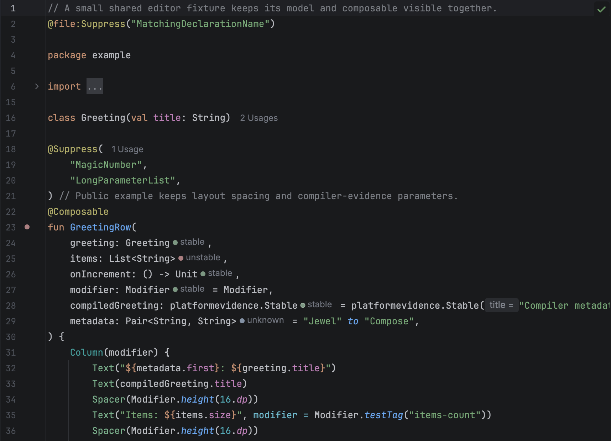

# Install the plugin

For IntelliJ IDEA 2026.2, get Jewel Tooling from [JetBrains Marketplace](https://plugins.jetbrains.com/plugin/34392-jewel-tooling) or a [GitHub Release](https://github.com/rock3r/jewel-tooling/releases). You can also build a ZIP with JDK 25 and install it from disk. The plugin targets JVM 21 bytecode. Its host IDE uses JBR 25.

```sh
./gradlew :buildPlugin
```

Open **Settings → Plugins** in IntelliJ IDEA. From the gear menu, choose **Install Plugin from Disk**. Select `build/distributions/jewel-tooling-0.9.0.zip`. Restart the IDE if prompted.

To build with an existing compatible IDE, supply its path:

```sh
./gradlew -PlocalIdePath=/path/to/IntelliJIDEA.app/Contents :buildPlugin
```

The plugin sets no upper IDE build limit. Newer IDEs can install it, but testing covers only build 262.8665.337. Newer IntelliJ IDEA and Android Studio builds may require API compatibility fixes.

## Open a project

Import the Gradle or Bazel project to inspect. Wait for synchronization and indexing to finish. Jewel Tooling uses the IDE's resolved source roots, dependencies, Compose annotations, and parameter types. Editing never runs Bazel or parses build output.

For applications such as Jewel Standalone, use the normal Gradle import.

For Bazel, import the project's supported IntelliJ model. The IDE needs that model to define source roots, classpaths, and Kotlin compiler options. Bazel build files alone cannot supply them. Include the build's Compose compiler plugin in the model, especially for libraries with Kotlin 2.4 composable function types.

Tests do not cover Kotlin Multiplatform source-set models. The plugin leaves unannotated types from other source modules unknown. For supported compiled dependencies, it can read compiler metadata.



Attached Kotlin sources, including Compose runtime sources, show parameter hints, function gutter icons, and live duration badges. These features match those in project files. Decompiled class files without source have no hints.

Use this repository's Gradle wrapper to build Jewel Tooling. Inspected projects can use their own build systems.
