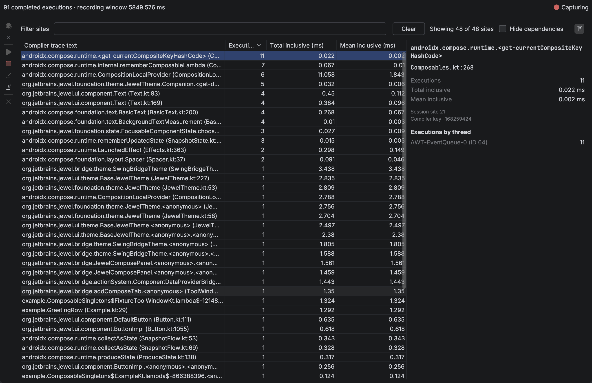

# Live inspection

Use **Run with Compose Inspection** with the configuration that normally starts your Compose UI. Jewel Tooling launches a temporary copy and connects to the target. Capture begins when the target loads Compose.

The target requires a local JVM, version 21 or newer. Launch requires no extra dependency, source edit, or copied connection token.

## Launch

1. Choose **Run with Compose Inspection** beside Run and Debug, from the configuration gutter, or from **Run → Run with Compose Inspection**. The default shortcut is Ctrl+Alt+Shift+F10. On macOS, use Ctrl+Option+Shift+R.
2. Interact with the application. Read execution counts in **Compose Inspection → Live recompositions**.
3. Click **Stop Capture**. Choose **Export Recording** to save the result. Use the notification to reveal the file in your system file manager. **Import Recording** loads a saved session into the tab and editor badges. **Close Recording** clears the session.

To prepare the agent before launch, choose **Tools → Install Inspection Support**.

The temporary configuration runs your existing build steps before starting the application. Jewel Tooling leaves the saved configuration unchanged. The normal **Run** action launches without the inspection agent.

Inspection connections support local hosts only.

### Jewel Standalone and Gradle

Select a Gradle configuration with one explicit application task, such as `:desktop:run`. If modules share a task name, use its full path. The selected task must use `JavaExec` directly. Delegating to another task does not qualify. During project configuration, inspection ignores included Gradle plugin builds until the application task enters the task graph.

Jewel Tooling adds the agent only to the application JVM. The Gradle daemon receives no agent. The temporary launch disables Gradle's configuration cache without changing project configuration. Inspection excludes remote targets, compound configurations, and `runIde` split mode.

### IntelliJ Platform and Bazel

Import the project's supported IntelliJ model. Select its local **Application** or **Kotlin** run configuration. Retain any Bazel build step the project requires. Choose **Run with Compose Inspection**.

The configuration must start the target IDE in a separate JVM. Interact with the plugin UI in that IDE to generate trace events. The authoring IDE receives events in **Compose Inspection**. The agent's bytecode reader supports JBR 25.

Use the project's existing development IDE launch configuration. Jewel Tooling cannot create one from an arbitrary Bazel command.

## Read the live capture

Read capture state, completed executions, and the recording window in **Live recompositions**. Select a trace site to open its side-pane details. The table filter supports completion from recorded compiler text.

Initially, the table sorts executions from highest to lowest. Double-click a row to open its resolved Kotlin file. **Hide dependencies** keeps project-source sites and hides library sites, including Compose and Jewel.

For matching Kotlin sources, duration badges appear at the end of function or property lines. Dependency sources also support badges. Hover over a badge to read execution count and its share of recorded inclusive time. Badges use the live table's millisecond format. Click a badge to select its site in the tool window. Click a resolved file name in the details pane to open the Kotlin source.

The recording window measures elapsed capture time. An inclusive duration includes time in nested calls.

**Waiting for Compose** identifies a connected target that has not loaded Compose. Open a Compose UI in the target. A supported runtime starts capture automatically. Unsupported runtimes or multiple runtime copies stop capture and show an explanation. The agent receives callbacks on the composition thread. A low-priority background thread pairs events, totals sites, and writes the event log. Composition therefore avoids access to the recording store.

## Stop, disconnect, and limits

Use **Stop Capture** to end recording while the application runs. **Disconnect Target** closes inspection without stopping the application. After disconnecting, launch with inspection again to reconnect. To stop the application, use **Stop** in the Run tool window.

Hover over capture status to see which limit ended recording. Capture stops at 100,000 completed executions, 1,024 sites, 64 threads, depth 64, or one hour.

Before starting another capture, confirm discarding any nonempty unexported result. For an ended capture, **Cancel** preserves the result. During capture, **Keep Recording** preserves the running session. Confirmed final results remain exportable after disconnection. Disconnecting during capture leaves an incomplete snapshot that cannot be exported as a final recording.

Load saved files through **Import Recording** or **Tools → Open Compose Recording**. Import replaces the current result and disconnects any live target. **Close Recording** clears the result and duration badges. Importing and closing both require confirmation before discarding a nonempty unexported result.

The live view cannot identify initial composition, skipped calls, invalidation causes, or composition instances. Without compiler trace markers, activity can remain invisible. An empty view cannot establish that the application is idle.

Session limits are 100,000 completed executions, 1,024 sites, 64 threads, and nesting depth 64. Each site's compiler text has a 1 KiB limit. Files have a 24 MiB limit. Capture lasts at most one hour. Live snapshots contain per-site totals. Stopping capture reads the full event list from the target.

At a limit, capture ends with a **Truncated** result. The recorder drops unfinished root segments and reports their counts. The extent of later, unrecorded activity remains unknown. A clock failure creates a **Failed** recording. Its report retains events completed before the failure.

Target, compiler, runtime, and build labels declare information without verifying build identity. Runtime classloader identity stays unknown. Each session remains separate.

An authenticated loopback connection links inspection to the configured development target. Automatic launches observe Compose trace callbacks through a startup agent. Contributors can use the older manual path described in [Recording adapter](../docs/recording-adapter.md).
