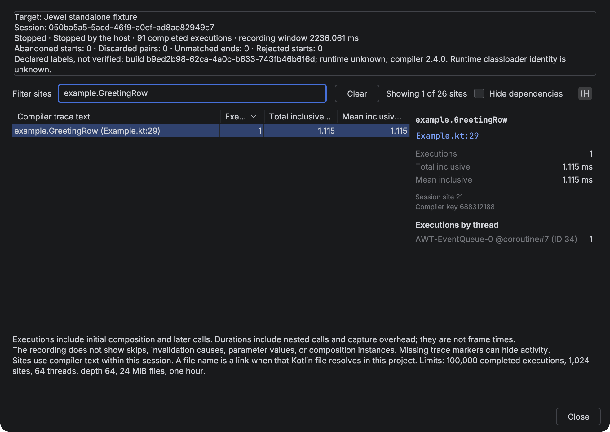
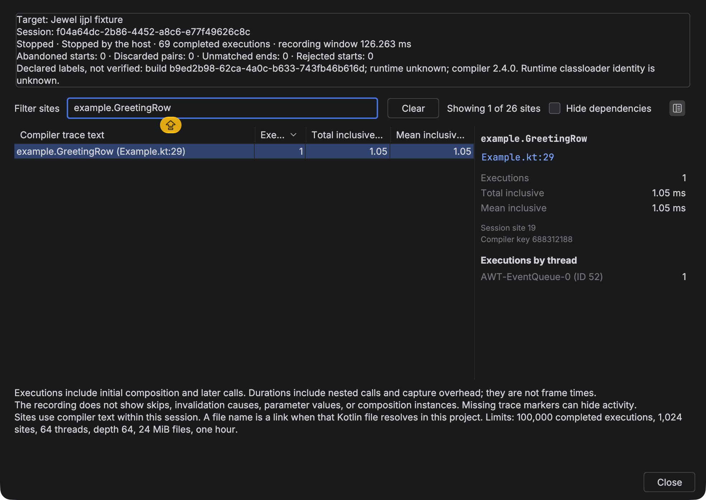

# Recordings

Open a saved session through **Tools → Open Compose Recording** or **Live recompositions → Import Recording**. **Find Action** also offers the open action. Select an export from **Run with Compose Inspection** or a recording generated by the repository fixtures.

The **Live recompositions** tab displays the saved session. Matching Kotlin sources show inclusive duration badges, as they do during live capture. Sort sites by clicking a column heading. Select a site to inspect its declaration, file link, measurements, and executions by thread. The details support text selection and copying. Use **Close Recording** to clear the session and badges.

Importing disconnects any live target. Both opening and closing require confirmation before discarding nonempty unexported results. Closing an imported file needs no confirmation because that file already exists on disk.





## Filter and navigate

Search full compiler trace descriptions with **Filter sites**. Search ignores case. It treats spaces and punctuation literally. Press Ctrl+Space to complete recorded compiler text, declaration names, or file names. Entering `example.GreetingRow`, for example, finds that call site. **Clear** restores every row.

**Hide dependencies** excludes sites outside project sources. The result count compares visible sites with all recorded sites. Filters leave session totals and per-site measurements unchanged.

The initial sort lists the highest execution counts first. To open Kotlin source, double-click its row or click its resolved file name in the details pane.

One execution means one completed pair of Compose trace callbacks. The callbacks cannot distinguish initial composition from later calls. Total and mean durations include nested calls and capture overhead. They cannot measure frame times.

Within a session, a compiler key and its exact text identify a site. A shared function name cannot establish a shared composition instance. The details pane links file names only when the Kotlin file and package resolve in the project or dependencies. Unresolved file names remain plain text. Recordings have no verified source map.

Reports omit skips, invalidation causes, parameter values, and composition instances. Missing or disabled trace markers can leave activity unrecorded. Empty recordings cannot establish that the target did no work.

Import rejects malformed, incomplete, oversized, or unsupported files. The importer reads compiler text only as plain text. It cannot interpret that text as paths or commands. Saved recordings remain local.

## Fixture recordings

The demos generate saved recordings through automated graphical tests. Use them to check repository setup or inspect a saved report. They run fixture applications without using the live controls.

With JDK 25 and a display available, run these commands from the `jewel-tooling` repository root:

```sh
./gradlew :e2e:driver-plugin:exportFixtureSdk
./gradlew -p fixtures/standalone test
```

The test launches the demo and captures an **Add item** click. It then stops capture and writes `fixtures/standalone/build/capture/recording.json`. Open that file with **Tools → Open Compose Recording** in your IDE.

See the [testing guide](../docs/testing.md) for the Bazel and IJPL demo. IJPL scenarios each write `recording.json` to their artifact directory under `e2e/runner/build/artifacts`.
